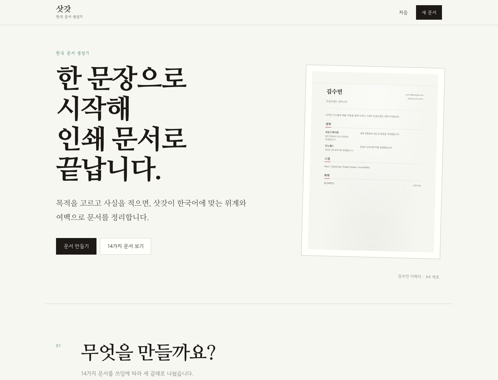

<div align="center">

# 삿갓 · satgat

**자연어를 한국형 인쇄 문서로 옮기는 웹 제품이자 오픈소스 디자인 시스템.**

백자지 위에 먹글씨, 페이지의 5%를 넘지 않는 단청 한 점.
14개 문서를 같은 React 렌더러로 미리 보고, 공유하고, PDF로 내보냅니다.

[웹앱](https://satgat.vercel.app/ko) · [완성 예시](https://satgat.vercel.app/ko/examples) · [npm](https://www.npmjs.com/package/satgat) · [MIT License](LICENSE)

[](LICENSE)
[](https://www.npmjs.com/package/satgat)
[](https://nextjs.org)



</div>

---

## 1분 안에 만들기

1. [satgat.vercel.app/ko](https://satgat.vercel.app/ko)에서 문서 종류를 고릅니다.
2. 목적, 독자, 반드시 들어갈 사실을 한 문장으로 적습니다.
3. 필요할 때만 브랜드 정보를 켜고 이름·역할·웹사이트·톤을 입력합니다.
4. `문서 만들기`를 누른 뒤 결과를 검토합니다.
5. `PDF 내려받기`, `인쇄 / PDF 저장`, 또는 명시적 확인 뒤 `링크 복사`를 사용합니다.

```text
7년차 프론트엔드 개발자 이력서. 커머스 플랫폼 성능 개선과 디자인 시스템 구축 경험을 강조해 주세요.
```

입력은 최대 1,200자입니다. 사실 확인 목록이 있는 템플릿은 생성 화면에서 필요한 정보를 먼저 알려 줍니다.

## 웹앱 사용

| 화면 | 역할 |
|---|---|
| `/ko` | 14개 템플릿 카탈로그, 실제 specimen, 제품 설명 |
| `/ko/examples` | React 런타임에서 생성한 14개 PNG/PDF 완성 예시 |
| `/ko/new?template=<id>` | 템플릿 선택, 프롬프트 작성, 선택적 브랜드 정보 입력 |
| `/ko/preview?draft=<uuid>` | 현재 브라우저의 임시 초안을 읽어 문서 미리보기 |
| `/ko/preview#share=<payload>` | 사용자가 확인한 뒤 만든 내용 포함 공유 링크 |

생성 결과는 템플릿별 슬롯 스키마로 검증한 뒤 렌더링합니다. 일반 미리보기 주소에는 UUID만 들어가며 문서 내용은 현재 탭의 `sessionStorage`에 보관됩니다. 공유 링크는 별도 동작이며, 복사 전에 링크에 문서 내용이 들어간다는 경고를 표시합니다.

화면 미리보기, specimen PNG, 서버 PDF, 브라우저 인쇄는 모두 `SatgatTemplateRenderer`와 `SatgatPrintStyles`를 사용합니다. 정적 HTML 데모를 별도 렌더러로 유지하지 않습니다.

## 셀프호스팅

### 새 작업 디렉터리

```bash
npx satgat init my-satgat
cd my-satgat
npm install
echo "GOOGLE_GENERATIVE_AI_API_KEY=<키>" > .env.local
npm run dev
```

`npx satgat init`은 공식 저장소의 최신 얕은 clone을 만들고 패키지를 private 앱으로 바꿉니다. 생성 기능에는 Google Generative AI 키가 필요합니다. 카탈로그와 기존 specimen 열람에는 키가 필요하지 않습니다.

### 원본 저장소

```bash
git clone https://github.com/unclejobs-ai/satgat.git
cd satgat
npm install
cp .env.example .env.local
npm run dev
```

프로덕션은 `npm run build` 뒤 `npm run start`로 실행합니다. 서버 PDF는 Chromium을 사용합니다. 로컬에서는 `CHROMIUM_PATH`로 실행 파일을 지정할 수 있고, 미지정 환경에서는 패키지의 서버리스 Chromium 구성을 사용합니다.

## AI agent skill

Claude Code 등 skill 디렉터리를 읽는 에이전트:

```bash
npx satgat skill ~/.claude/skills/satgat
```

이 명령은 `skills/satgat/SKILL.md`와 `references/`를 지정한 위치에 복사합니다. Codex·Cursor처럼 프로젝트 지침을 읽는 도구에서는 설치된 `SKILL.md`를 `AGENTS.md`에서 참조하세요.

호출 예시:

```text
삿갓 규칙으로 시드 투자 IR 덱을 만들어 주세요. 문제, 해결, 시장, 트랙션, 비즈니스 모델, 팀, 요청 금액을 포함해 주세요.
```

skill은 시각 규칙과 콘텐츠 계약을 제공하는 지침입니다. 웹앱을 실행하거나 로컬 파일의 브랜드 정보를 읽는 플러그인이 아닙니다.

## 14개 문서와 실제 출력 형식

| 문서 | ID | PageSpec | 실제 출력 |
|---|---|---|---|
| 이력서 | `resume` | A4 세로 | 1쪽 PDF/PNG |
| 자기소개서 | `self-intro` | A4 세로 | 1쪽 PDF/PNG |
| 명함 | `business-card` | 명함 8-up | A4 한 장에 90×55mm 명함 8면 |
| 브랜드 원페이지 | `brand-onepager` | A4 가로 | 1쪽 PDF/PNG |
| 제품 소개서 | `product-brochure` | A4 세로 | 1쪽 PDF/PNG |
| 회사 소개서 | `company-profile` | A4 세로 | 1쪽 PDF/PNG |
| 투자 IR 덱 | `investor-deck` | 16:9 슬라이드 | 9장 PDF/PNG 미리보기 |
| 브랜드 스토리북 | `brand-storybook` | A4 세로 | 1쪽 PDF/PNG |
| 청첩장 | `invitation` | 엽서 세로 | 105×148mm 1면 |
| 연하장 | `new-year-card` | 엽서 세로 | 105×148mm 1면 |
| 제안서 | `proposal` | A4 세로 | 1쪽 PDF/PNG |
| 뉴스레터 | `newsletter` | A4 세로 | 1쪽 PDF/PNG |
| 포트폴리오 | `portfolio` | A4 가로 | 1쪽 PDF/PNG |
| 보고서 | `report` | A4 세로 | 1쪽 PDF/PNG |

지원 시각화: 막대, 선, 도넛, 폭포, 타임라인, 흐름도, 구성도, 사분면, 벤 도표, 레이어 스택.

완성 예시는 [`/ko/examples`](https://satgat.vercel.app/ko/examples)에서 보고, 생성 계약은 [`manifest.json`](public/satgat/assets/examples/ko/manifest.json)에서 확인할 수 있습니다. `npm run specimens:render`는 프로덕션 React 경로를 열어 같은 14개 PNG/PDF를 다시 만듭니다.

## 데이터 처리와 공유

- **임시 초안:** 생성 결과와 현재 초안 ID는 브라우저 탭의 `sessionStorage`에 저장됩니다. 탭을 닫으면 유지된다고 가정하지 마세요.
- **AI 생성:** 프롬프트와 선택한 브랜드 정보는 `/api/generate`를 거쳐 설정된 Google Generative AI 서비스로 전송됩니다.
- **PDF:** 현재 문서 데이터는 `/api/export`로 전송되어 서버의 Chromium에서 PDF로 렌더링됩니다.
- **일반 미리보기:** URL에는 문서 내용 대신 무작위 UUID만 포함됩니다. 다른 브라우저나 기기에서 그 주소만 열어도 문서가 전달되지 않습니다.
- **공유 링크:** 사용자가 공유 대화상자에서 확인한 경우에만 문서 데이터를 URL fragment에 넣습니다. 서버 요청에는 fragment가 포함되지 않지만, 링크를 받은 사람은 내용을 읽을 수 있습니다. 개인정보가 있는 문서는 공유하지 마세요.
- **계정·DB:** 현재 소스에는 인증이나 서버 문서 저장소가 없습니다.

배포 전에는 사용하는 AI 제공자, 로그, 프록시, 호스팅 환경의 개인정보 정책을 별도로 검토하세요.

## 개발·검증

Node.js 20.9 이상과 npm을 기준으로 합니다. 테스트 러너는 Bun입니다.

```bash
npm run dev                 # Next.js 개발 서버
npm run lint                # ESLint
npx tsc --noEmit            # TypeScript 검사
npm test                    # Bun 테스트 전체
npm run build               # 프로덕션 빌드
npm run tokens:check        # constraint.ts → 생성 토큰 drift 검사
npm run verify:templates    # 14개 정의·registry·렌더러·아티팩트 계약
npm run verify:web          # 실행 중인 프로덕션 앱의 브라우저·PDF 계약
npm run specimens:render    # 런타임 PNG/PDF/manifest 재생성
node scripts/design-guard.mjs --check
node scripts/design-guard.mjs --check-density
```

`verify:web`은 기본적으로 `http://127.0.0.1:3000`을 검사합니다. 먼저 프로덕션 서버를 실행하세요.

```bash
npm run build
npm run start -- --hostname 127.0.0.1 --port 3000
npm run verify:web
```

CI의 blocking 계약:

- `tokens:check`: `constraint.ts`에서 생성한 CSS·TypeScript 토큰과 저장된 파일의 drift 없음
- `verify:templates`: 정의, registry, React renderer, 14개 PNG/PDF/manifest 일치
- `design-guard --check`: raw Unicode escape, 순백, `rgba()`, 장식 한자, 관리되지 않은 토큰 등 오류 0개
- `lint`, `test`, `build`
- 실행 중인 프로덕션 앱에서 `verify:web`: 데스크톱·모바일 랜딩, 생성 흐름, 14개 미리보기와 PDF MediaBox

디자인 밀도 검사는 현재 advisory warning으로 보고하며 CI 실패 조건은 아닙니다.

### 단일 진실원천

```text
src/lib/design-system/constraint.ts       색·폰트·간격·그림자 원본
scripts/generate-design-tokens.mjs        CSS/TypeScript 토큰 생성기
app/satgat-tokens.css                     생성된 웹 토큰
src/lib/design-system/generated-tokens.ts 생성된 코드 토큰
src/lib/templates/definitions/            14개 슬롯·section·specimen 정의
src/lib/templates/registry.ts             PageSpec·카테고리·renderer 연결
src/components/templates/                 React 문서 렌더러
src/lib/engine/                            슬롯 정규화·검증·렌더 계약
src/lib/generation/                        AI 요청·응답 계약
scripts/verify-template-catalog.mjs        카탈로그·아티팩트 검증
scripts/verify-web-product.mjs             실행 제품·PDF 검증
skills/satgat/SKILL.md                     에이전트용 한국 문서 brief
```

### 디자인 8조

1. 캔버스는 백자지 `#F7F7F2`; 순백과 누런 양피지를 쓰지 않습니다.
2. 단청 `#9B1B1B`은 페이지의 5% 이내입니다.
3. 보조 강조는 취색 또는 금박 중 하나만 고릅니다.
4. 회색은 회녹 계열만 사용합니다.
5. 제목은 명조 600–700, 본문은 바탕 400; 위계는 크기로 만듭니다.
6. 문서 UI 색은 solid hex를 사용합니다.
7. 큰 여백을 디자인 요소로 취급합니다.
8. 합성 볼드와 장식 한자를 사용하지 않습니다. 한자는 필요한 고유명 옆 괄호 표기만 허용합니다.

전문은 [`skills/satgat/SKILL.md`](skills/satgat/SKILL.md), [`references/design.ko.md`](references/design.ko.md), [`references/anti-patterns.ko.md`](references/anti-patterns.ko.md)를 참조하세요.

## 영감과 라이선스

삿갓의 제약 기반 문서 디자인 접근은 [tw93/Kami](https://github.com/tw93/Kami)에서 영감을 받았습니다. 삿갓은 별도 코드와 런타임을 가진 독립 프로젝트입니다.

MIT © 2026 [unclejobs-ai](https://github.com/unclejobs-ai). 번들 폰트는 각 OFL·MIT 라이선스를 따릅니다.
