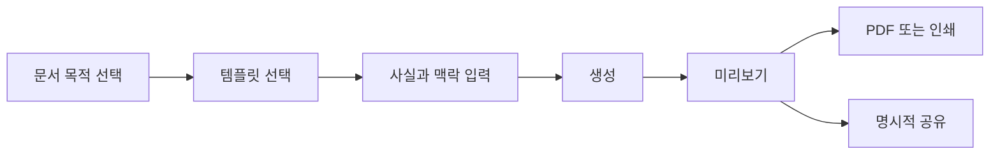

# 삿갓 웹 제품 재설계 명세

- **상태:** 설계 승인됨
- **일자:** 2026-07-11
- **제품 중심:** 웹앱 우선
- **범위:** 랜딩, 생성 흐름, 미리보기·PDF 계약, 디자인 시스템 권위, 템플릿 카탈로그, specimen 생성, README 및 검증 체계

## 1. 문제 정의

삿갓의 문서 결과물은 백자지·먹·단청·명조라는 명확한 시각 언어를 이미 갖고 있다. 그러나 현재 제품 셸은 동일한 제품을 여러 규칙과 여러 렌더러가 서로 다르게 설명한다.

### 관측된 사실

| 영역 | 관측 | 근거 |
|---|---|---|
| 랜딩 텍스트 | 템플릿 카드 메타가 `\\u00b7`, `\\uc9c0...` 같은 escape literal로 실제 배포 화면에 보인다. | `public/satgat/satgat-ko.html:214-279`, 2026-07-11 배포 화면 확인 |
| 모바일 | 390px에서 랜딩 카드가 약 76px 폭의 4열로 보인다. | 배포 화면 측정; `overrides.css:1920-1924`의 1열 rule이 `2077-2081`의 뒤쪽 4열 rule에 덮임 |
| 랜딩 밀도 | 배포 랜딩 높이는 1440px viewport에서 14,161px, 390px viewport에서 25,771px이다. | 2026-07-11 browser measurement |
| 예시 일관성 | 제품은 14 템플릿을 등록하지만 공개 specimen은 13개이고 보고서가 빠져 있다. | `registry.ts:17-36`, `scripts/generate-korean-demo-pack.mjs:1-3`, `public/satgat/assets/examples/ko/manifest.json:1-145` |
| 렌더러 이중화 | 런타임 React renderer와 static demo layout engine이 분리되어 있다. | `renderer.tsx:7-23`, `scripts/generate-korean-demo-pack.mjs:1-17` |
| 토큰 권위 | `constraint.ts`, `tokens.ts`, `globals.css`, `overrides.css`가 색·폰트·spacing을 중복 선언한다. | 각 파일의 token declaration |
| 한자 규칙 | 프로젝트 운영 규칙은 장식 한자를 금지하지만 registry seal, mini preview, slot 정의가 장식 한자를 중심으로 쓴다. | `registry.ts:50-66`, `NewDocumentClient.tsx:151-352`, `business-card.ts:9-16`, `invitation.ts:9-19` |
| 브랜드 약속 | brand resolver는 외부에서 사용되지 않고, 생성 API는 brand profile을 전달하지 않는다. | TypeScript references; `app/api/generate/route.ts:55-68` |
| 출력 형식 | 청첩장은 문서마다 A5·엽서·A4로 설명되며, 실제 렌더러는 A4 안에 148×210mm 카드를 놓는다. | `SKILL.md:66-72`, `README.md:121-130`, `Invitation.tsx:39-59` |
| CI | design guard는 일부 경로만 scan하며 warning이어도 항상 exit 0이다. CI는 unit test를 실행하지 않는다. | `design-guard.mjs:586-595,1052-1060`, `.github/workflows/ci.yml:27-70` |

### 감사 결론

- **문서 미감:** refine한다. 백자지·먹·단청·명조·인쇄 우선이라는 중심 언어는 보존한다.
- **제품 셸:** redesign한다. 랜딩과 생성 플로우는 설명 중심 구조를 버리고 문서 완성 중심으로 바꾼다.
- **시스템 경계:** clean cutover한다. runtime renderer와 canonical fixture를 유일한 출력 진실원천으로 만든다.

## 2. 제품 원칙

1. **웹앱이 주제품이다.** 일반 사용자는 `/ko/new`에서 문서를 시작하고 미리보기·PDF·인쇄로 끝낸다. CLI와 agent skill은 셀프호스팅 또는 통합 경로다.
2. **한국성은 장식량이 아니라 문서 사용성에서 나온다.** 한글의 줄길이, 행간, 인쇄 규격, 공문·채용·제안 관습, 절제된 색이 우선이다.
3. **한 문서에 chromatic accent는 하나다.** 기본은 단청이며, 취색 또는 금박을 쓸 때는 템플릿 단위로 선택하고 같은 페이지에 섞지 않는다.
4. **장식 한자는 사용하지 않는다.** 법적 이름 등 실제 사용자 데이터는 사용자가 제공한 경우에만 본문 인접 괄호 보조 표기로 허용한다.
5. **판매 화면은 실제 runtime output만 보여 준다.** 사람이 손으로 만든 static demo layout을 runtime 결과물의 증거로 쓰지 않는다.
6. **정직한 기능 설명이 디자인의 일부다.** 구현되지 않은 brand 자동 반영, 부정확한 page size, advisory rule을 CI gate라고 부르는 표현을 금지한다.
7. **인쇄 계약은 화면 계약과 동일한 데이터에서 나온다.** Preview, PDF, specimen, visual regression은 같은 fixture와 같은 renderer를 사용한다.
8. **private by default.** 일반 preview URL에는 문서 본문·이메일·전화 등 사용자 데이터를 넣지 않는다. 공유는 명시적 행동이고, 링크가 내용을 포함한다면 그 사실을 알린다.

## 3. 사용자 경험 설계

### 3.1 핵심 여정



### 3.2 랜딩 정보 구조

현재 랜딩의 시스템 카탈로그를 다음 여섯 블록으로 바꾼다.

1. **Hero — 한 문장으로 시작해 인쇄 문서로 끝난다**
   - 실제 runtime fixture로 만든 document image를 한 장만 사용한다.
   - Primary CTA: `문서 만들기`.
   - Secondary CTA: `14가지 문서 보기`.
   - token 나열, GitHub, 긴 manifesto는 hero에서 제거한다.

2. **문서 선택 — 세 목적군**
   - 개인: 이력서, 자기소개서, 명함, 포트폴리오.
   - 브랜드·업무: 브랜드 원페이지, 제품 소개서, 회사 소개서, 제안서, 투자 IR 덱, 스토리북, 뉴스레터, 보고서.
   - 초대·인사: 청첩장, 연하장.
   - desktop은 3열 또는 4열, 390px에서는 2열과 156px 이상 카드 폭을 보장한다. 카드가 내용상 더 넓어야 하면 목록형 1열을 택한다.

3. **생성 방법 — 세 단계**
   - 종이 선택 → 사실 입력 → 미리보기/PDF.
   - 차트·도표는 capability proof 한 장면만 둔다.

4. **대표 결과 — 세 장**
   - 개인, 업무, 초대에서 하나씩만 보여 준다.
   - 전체 14종 specimen은 `/examples`에서 제공한다.

5. **신뢰 정보**
   - 한국어 문서, PDF·인쇄, 무료 폰트, 데이터 처리 범위만 명시한다.
   - 브랜드 profile은 실제 적용되기 전까지 이 블록에 넣지 않는다.

6. **짧은 FAQ와 footer**
   - self-hosting, API key, agent skill은 README와 문서로 연결한다.

#### 랜딩 정량 목표

| 항목 | 현재 baseline | 목표 |
|---|---:|---:|
| 1440px landing height | 14,161px | 7,500px 이하 |
| 390px landing height | 25,771px | 12,000px 이하 |
| 390px template card width | 약 76px | 156px 이상 |
| 즉시 로드 specimen | 13개 PNG | hero 1개; 나머지는 viewport 진입 시 로드 |
| landing links | 45개 | 20개 이하의 핵심 경로 |
| specimen coverage | 13/14 | 14/14 |

### 3.3 생성 화면

생성 화면은 progressive disclosure를 따른다.

#### 단계 1 — 종이 고르기

- 카테고리로 먼저 좁히고 템플릿을 고른다.
- template card는 문서명, 용도, 실제 출력 형식만 보여 준다.
- `aria-label`은 `이력서 템플릿 선택`처럼 짧고 행동 중심으로 만든다.
- thumbnail 내부의 임의 텍스트를 button accessible name에 포함하지 않는다.
- 템플릿 구분은 한글 문서명, page spec, 얇은 accent line으로 한다. seal glyph는 제거한다.

#### 단계 2 — 사실 입력

- 템플릿을 고르기 전에는 prompt form을 보이지 않는다.
- prompt seed는 최대 두 개의 보조 버튼으로 제한한다.
- 숫자 점수 대신 누락된 사실을 알려 준다. 예: 이력서는 최근 경력·정량 성과·연락처, 제안서는 대상·문제·일정·예산.
- 사용자 오류는 친절한 message만 보여 준다. provider 또는 validation의 기술 오류 문자열을 client response에 실어 보내지 않는다.

#### 단계 3 — 결과

- document canvas가 toolbar보다 시각적으로 우선한다.
- `다시 만들기`, `PDF 내려받기`, `인쇄`, `공유`는 구분된 행동이다.
- loading, empty, generation error, PDF error, focus, disabled 상태를 fixture와 screenshot으로 검증한다.

### 3.4 Preview와 공유 계약

#### 일반 preview

1. 생성 결과는 browser `sessionStorage`에 random draft key로 저장한다.
2. URL은 `/ko/preview?draft=<opaque-key>` 형태이며, user content는 URL에 없다.
3. preview client는 draft key로 sessionStorage data를 읽어 runtime renderer를 호출한다.
4. PDF export는 이미 POST body로 보유한 slots를 사용한다. headless preview가 필요하면 browser context의 sessionStorage에 data를 주입한 뒤 인쇄한다.

#### 명시적 공유

1. 사용자가 `공유 링크 만들기`를 눌러야만 공유 URL을 만든다.
2. 초기 구현은 URL fragment에 base64url payload를 넣을 수 있다. fragment는 HTTP request·referrer에 전송되지 않지만 browser history에는 남는다.
3. 공유 dialog는 `이 링크에는 문서 내용이 포함됩니다. 개인정보가 있으면 공유하지 마세요.`를 명시한다.
4. 장기적으로 만료형 server-side share record를 도입할 수 있으나, 이번 redesign의 선행조건은 아니다.

## 4. 시각 언어 설계

### 4.1 보존하는 foundation

| 역할 | 결정 |
|---|---|
| Canvas | `#F7F7F2` 백자지. 순백 사용 금지. |
| Ink | `#1C1916` primary, `#3A3833` body, `#4D4B46` caption, `#6B6862` meta. |
| Primary accent | `#9B1B1B` 단청. 한 페이지 면적의 5% 이하. |
| Secondary accent | 취색 또는 금박 중 하나만 template variant로 선택. 기본 문서에는 불필요하면 사용하지 않는다. |
| Display | Nanum Myeongjo의 실제 700 또는 800. |
| Body | Gowun Batang 400. |
| Label | Gowun Dodum 400. |
| Shape | 얇은 line, 작은 radius, 최소한의 tinted shadow. |
| Texture | 단일 미세 grain과 매우 절제된 vignette. watermark·강한 changsal 패턴은 사용하지 않는다. |

### 4.2 제거하는 표현

- decorative Hanja seal, 대형 한자 headline, template glyph badge.
- 색동·오방색·사계·정서 색 alias처럼 제품 UI가 실제로 쓰지 않는 토큰군.
- 한 페이지 내 단청·취색·금박 동시 사용.
- multiple gradient와 강한 paper effect.
- static mini mock의 임의 인물·한자·가짜 성과 데이터를 accessibility label에 포함하는 방식.

### 4.3 typography 규칙

- `font-weight: 600`은 해당 family가 제공하는 실제 face일 때만 허용한다.
- Display/H1은 Nanum Myeongjo 700/800, 본문은 Gowun Batang 400, label은 Gowun Dodum 400을 기본으로 한다.
- Latin italic은 Cormorant Garamond를 문장 내 보조로만 쓴다.
- 한글 본문은 1.7 이상 line-height, body width는 읽기 가능한 범위로 제한한다.
- meta는 contrast ratio 4.5:1 이상을 유지한다. 2026-07-11 live sample의 `.lc-meta`는 5.17:1로 통과했으므로 이보다 낮추지 않는다.

## 5. 템플릿과 출력 시스템

### 5.1 Single Template Catalog

모든 template metadata를 하나의 catalog record에 정리한다.

```ts
// src/lib/templates — domain data only; React import 금지
interface TemplateCatalogEntry {
  id: TemplateId;
  name: string;
  category: 'personal' | 'business' | 'occasion';
  pageSpec: PageSpec;
  slots: TemplateSlot[];
  contentOutline: ContentOutline;
  promptSeeds: readonly string[];
  factChecklist: readonly string[];
  canonicalFixture: SlotValues;
  specimen: SpecimenMetadata;
}

// src/components/templates — UI adapter; TemplateId 전체성을 검증
type TemplateRendererCatalog = Record<
  TemplateId,
  React.LazyExoticComponent<React.ComponentType<{ data: SatgatDocumentData }>>
>;
```

이 구조는 generic document renderer를 도입하기 위한 것이 아니다.

- Domain catalog에는 React를 넣지 않는다. UI renderer map은 adapter 계층에서 `TemplateId`의 exhaustive `Record`로 유지하고 catalog verifier가 양쪽 key set을 검증한다.
- 14개 장르는 계속 각자의 React renderer를 가진다.
- `contentOutline`은 prompt, validation, README, template picker의 설명용 구조다.
- `pageSpec`은 preview, PDF, fixture, specimen이 함께 쓰는 물리 출력 계약이다.
- `canonicalFixture`는 runtime visual regression과 specimen artifact의 유일한 source다.

### 5.2 PageSpec

| PageSpec | 사용 템플릿 | 물리 계약 |
|---|---|---|
| `a4Portrait` | 이력서, 자기소개서, 제품 소개서, 회사 소개서, 제안서, 뉴스레터, 스토리북, 보고서 | 210×297mm |
| `a4Landscape` | 브랜드 원페이지, 포트폴리오 | 297×210mm |
| `slide16x9` | 투자 IR 덱 | 297×167mm |
| `businessCard8Up` | 명함 | 90×55mm card를 A4 sheet에 impose |
| `postcardPortrait` | 청첩장, 연하장 | A6 105×148mm |

청첩장과 연하장은 A4 안의 축소 카드가 아니라 독립 page spec으로 인쇄한다. 필요하면 postcard sheet imposition은 별도의 print mode로 제공한다.

### 5.3 Runtime renderer가 진실원천

현재 static demo pipeline은 `scripts/demo/data.mjs`, `layouts.mjs`, `css.mjs`로 runtime과 별도 레이아웃을 만든다. 이를 없앤다.

1. canonical fixture를 runtime preview route에서 렌더한다.
2. headless Chromium이 동일한 renderer를 PNG/PDF로 캡처한다.
3. generated manifest가 `/examples`, landing hero, README links를 채운다.
4. 14개 entry 모두 specimen을 가져야 한다.
5. static gallery는 artifact consumer만 되고 layout author가 되지 않는다.

### 5.4 컴포넌트 경계

- `NewDocumentClient.tsx`는 orchestration만 남긴다.
- `TemplatePicker`, `TemplateCard`, `TemplatePreview`, `PromptComposer`, `FactChecklist`, `CreateResult`, `ExampleGallery`를 기능 단위로 분리한다.
- `NewDocumentClient.tsx`의 inline `<style jsx>`는 feature stylesheet 또는 CSS module로 옮긴다.
- 500 LOC를 넘는 template renderer는 장르 내부 section component로 나눈다. 그러나 서로 다른 장르의 composition을 generic DSL로 합치지 않는다.
- shared primitive는 `SatgatDocument`, `SectionHeading`, `SatgatDivider`, table, metric, visual wrapper까지만 둔다.

## 6. 토큰 권위

### 6.1 문제

현재 token declaration이 TS와 CSS에 중복되며 alias가 누적되어 실제 디자인 규칙과 CSS cascade를 추적하기 어렵다.

### 6.2 결정

1. `src/lib/design-system/constraint.ts`를 semantic token authority로 둔다.
2. CSS variables는 constraint source에서 generated `tokens.css`로 만든다.
3. runtime CSS는 `var(--satgat-...)` semantic variable만 사용한다.
4. React inline style이 필요한 print dimension·calculated value만 typed token import를 허용한다.
5. 중복된 `tokens.ts`와 legacy alias는 제거한다. 새 compatibility alias는 만들지 않는다.
6. `globals.css`는 framework entry와 base document style만 맡는다.
7. `overrides.css`는 component layout rule만 맡고 token dictionary, legacy demo, repeated mobile override를 소유하지 않는다.

### 6.3 토큰 예외

- shadow와 grain이 정말 필요할 때만 opacity expression을 쓴다.
- tag, badge, accent surface는 solid hex를 사용한다.
- exception은 token name으로만 선언하고 design guard가 allowlist와 이유를 검사한다.

## 7. Brand profile 계약

웹앱 우선 제품에서 `~/.config/satgat/brand.md`는 일반 웹 사용자의 자동 입력 수단이 아니다.

1. 웹앱은 optional brand panel 또는 browser-local brand profile을 제공한다.
2. 사용자가 profile을 적용한 경우에만 generation request에 brand payload를 넣는다.
3. API route는 `generateDocumentData(template, prompt, brandProfile)`로 전달한다.
4. self-host/agent 환경의 `brand.md`는 별도 adapter로 같은 domain profile을 만든다.
5. 이 end-to-end path가 검증되기 전에는 README와 skill에서 자동 반영을 주장하지 않는다.

## 8. 검증 설계

### 8.1 계층

| 계층 | 성격 | 실패 예시 |
|---|---|---|
| Contract | blocking | catalog, picker, renderer, page spec, fixture, specimen 중 하나가 없는 경우 |
| Design | blocking | raw unicode escape, pure white, decorative Hanja, dual accent, mobile overflow, template card minimum width 위반 |
| Visual | review gate | landing/create/14 preview screenshot diff |
| Advisory | non-blocking | density heuristic, accent area estimate, 카피 tone hint |

### 8.2 필수 검증

1. 1440px와 390px의 landing screenshot.
2. 1440px와 390px의 create flow screenshot.
3. 14개 canonical fixture의 runtime preview screenshot.
4. template별 PDF page size assertion.
5. keyboard-only: template selection → prompt → generate CTA → preview action.
6. screen reader: template card accessible name이 문서명과 행동만 포함하는지 확인.
7. generated preview가 lazy fallback을 벗어나 실제 `.satgat-document`를 렌더하는지 timeout assertion.
8. normal preview URL에 fixture의 email, phone, text가 없는지 assertion.
9. brand profile input → API prompt → output의 end-to-end test.
10. README command smoke test.
11. unit test를 CI에서 실제 실행.

### 8.3 design guard 변경

- `app/`, `src/`, `public/satgat/`, generated page surface를 모두 scan target에 넣는다.
- `warn mode`는 advisory rule에만 유지한다.
- raw escape, pure white, mobile layout guard, template coverage, decorative Hanja는 CI failure로 승격한다.
- generic `// permit`는 예외 사유와 ticket/reference 없이 허용하지 않는다.

## 9. README 설계

README는 웹앱부터 시작하고, 셀프호스팅과 agent skill을 분기한다.

```md
# 삿갓
한 문장으로 시작해, 한국어 인쇄 문서로 끝냅니다.

[웹에서 문서 만들기] [14가지 예시] [셀프호스팅] [AI agent skill]

## 1분 안에 만들기
## 오늘 가능한 것
## 웹앱 사용
## 셀프호스팅
## AI agent skill
## 14개 문서와 실제 출력 형식
## 데이터 처리와 공유
## 품질 계약
## 개발·검증
## 구조와 기여
```

### README 필수 내용

- 웹앱은 설치·가입 없이 시작한다는 primary path.
- `npx satgat init`은 template scaffold가 아니라 remote Git clone을 수행하므로 Git 필요.
- self-host에 필요한 Node version, API key, PDF용 Chromium 조건.
- package manager와 test runner의 실제 선택. 현재 README는 npm command를 제시하지만 test script는 Bun runtime을 요구하므로 하나로 정리한다.
- 14개 문서의 정확한 PageSpec.
- default preview와 explicit share의 개인정보 처리 범위.
- brand profile의 실제 지원 상태.
- design guard의 blocking/advisory 구분.

### README에서 이동할 내용

| 내용 | 새 위치 |
|---|---|
| 폰트 전체 catalog | `docs/design-system.md` |
| 디자인 8조 전문 | `skills/satgat/SKILL.md`와 design docs |
| 전체 specimen table | generated `/examples` |
| 과거 SaaS roadmap | architecture decision log 또는 history 문서 |
| 중복된 CLI·skill 설명 | web / self-host / skill 비교 표 하나 |

## 10. 구현 단계

### Phase 1 — Truth pass

- raw escape 문자, mobile grid cascade, 14/13 specimen gap, inaccurate PageSpec, false brand claim을 고친다.
- decorative Hanja와 Hanja-only slot을 clean cutover로 제거한다.
- 이 단계의 목적은 배포 사용자에게 보이는 명백한 결함을 먼저 닫는 것이다.

### Phase 2 — Product shell

- landing six-block IA.
- category-first template picker.
- progressive prompt flow.
- concise accessible names, skip link, keyboard path, loading/error/focus states.

### Phase 3 — Canonical catalog and specimen

- single TemplateCatalog.
- PageSpec contract.
- runtime fixture screenshot/PDF pipeline.
- 14/14 examples.

### Phase 4 — Design-system and renderer boundary

- semantic token authority and generated CSS variables.
- stylesheet cascade cleanup.
- large client/template component decomposition.
- unique genre renderer 유지.

### Phase 5 — Privacy, brand, verification

- private preview and explicit share.
- brand profile end-to-end connection.
- CI contract/design/visual validation.

### Phase 6 — Documentation cutover

- web-app-first README.
- architecture document의 현재 상태만 남기고 historical roadmap 분리.
- skill, README, landing, template catalog claim을 하나의 manifest에서 생성 또는 검증.

## 11. 비목표

- 14종을 generic drag-and-drop document builder로 바꾸지 않는다.
- 새 UI framework 또는 design library를 추가하지 않는다.
- 한국성을 위해 장식·색·texture의 양을 늘리지 않는다.
- 영문/다국어 확장을 이번 개선의 근거로 사용하지 않는다.
- runtime renderer의 장르별 composition을 하나의 DSL로 강제하지 않는다.

## 12. 완료 기준

1. 랜딩과 생성 화면이 웹앱 첫 사용자에게 한 개의 주 행동만 명확히 제시한다.
2. 390px에서 모든 template card가 읽히고 horizontal overflow가 없다.
3. 배포 화면에 literal escape text가 없다.
4. 14 template 모두 정확한 page spec, renderer, fixture, specimen을 갖는다.
5. specimen과 runtime output은 같은 fixture와 renderer에서 나온다.
6. 디자인 토큰의 semantic authority가 하나이며 CSS cascade로 mobile rule이 역전되지 않는다.
7. 장식 한자와 unconnected brand profile claim이 없다.
8. normal preview URL에 PII가 없다.
9. PDF page size와 preview page spec이 일치한다.
10. contract/design/visual/unit checks가 CI에서 실행되고, blocking rule은 실제 failure를 만든다.
11. README는 웹앱 사용자, self-host 사용자, agent skill 사용자의 경로를 서로 혼동하지 않는다.
